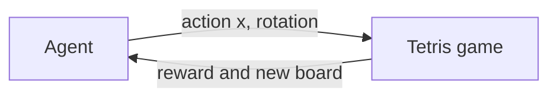
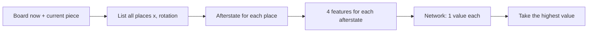
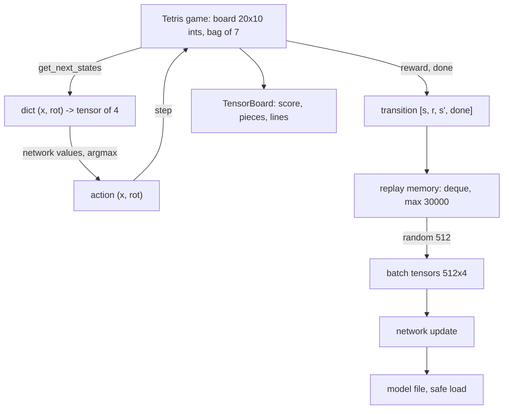
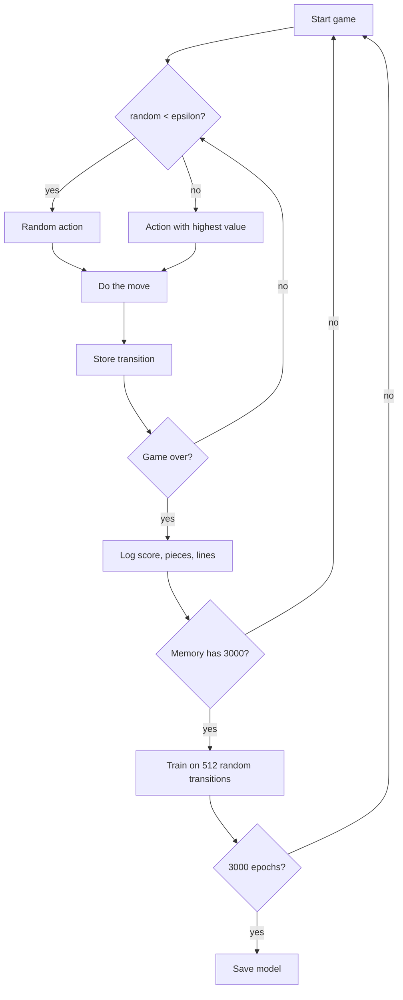

# Lecture: teach a computer to play Tetris with Deep Q-Learning

🇻🇳 Vietnamese version: [lecture.vi.md](lecture.vi.md)

This lecture explains the project from the first idea to the methods and the next topics to study.
It is for readers with no AI background. Each new term has a short definition at its first use.
The notebooks give the same topics as hands-on lessons:
[Lesson 1](../../notebooks/01_game_and_state.ipynb),
[Lesson 2](../../notebooks/02_network_and_decisions.ipynb),
[Lesson 3](../../notebooks/03_training_loop.ipynb),
[Lesson 4](../../notebooks/04_reward_lab.ipynb).

## Contents

1. [The idea](#1-the-idea)
2. [The game as data: data structures](#2-the-game-as-data-data-structures)
3. [The AI methods](#3-the-ai-methods)
4. [The training loop, step by step](#4-the-training-loop-step-by-step)
5. [Metrics: how we know that it learns](#5-metrics-how-we-know-that-it-learns)
6. [What the agent learned](#6-what-the-agent-learned)
7. [Limits of this design](#7-limits-of-this-design)
8. [Topics to study next](#8-topics-to-study-next)
9. [Glossary](#9-glossary)
10. [References](#10-references)

---

## 1. The idea

### 1.1 Learn from rewards, not from examples

Most programs follow rules that a person writes. This project has no rule such as "do not make holes".
Instead, the program plays many games and gets a number after each move. The number says "good" or "bad".
The program changes itself to get more of these numbers. This is **reinforcement learning (RL)**.

The 5 parts of RL in this project:

| RL term | Meaning | In this project |
|---|---|---|
| **Agent** | the program that decides | the neural network plus the choice rule |
| **Environment** | the world that the agent acts in | the Tetris game, `src/tetris.py` |
| **State** | what the agent knows about the world now | 4 numbers that describe the board |
| **Action** | what the agent can do | a final place for the piece: `(x, rotation)` |
| **Reward** | the number after each action | `1 + lines² × 10` |



### 1.2 Three design decisions make the problem small

1. **The agent chooses the final place of the piece.** It does not press left, right or rotate.
   The game lists every possible final place. So one decision = one piece.
2. **The agent sees 4 numbers, not 200 cells.** A person chose these 4 features:
   lines cleared, holes, bumpiness and height. A very small network can learn from 4 numbers in minutes.
3. **The agent scores boards, not moves.** For each possible place, the game makes the board that would
   follow (an **afterstate**). The network gives each afterstate one number (its **value**).
   The agent takes the place with the highest value.



These decisions trade generality for speed. The agent cannot discover new features. But it learns to play well
on a laptop CPU in about 5 minutes.

---

## 2. The game as data: data structures

### 2.1 The board

The board is a list of 20 rows. Each row is a list of 10 integers.

- `0` = an empty cell
- `1` to `7` = a block of one piece type (the number sets the color)

```python
board = [[0] * 10 for _ in range(20)]   # row 0 is the top
```

### 2.2 The pieces and the bag

`Tetris.pieces` holds 7 small grids, one for each **tetromino** (a shape of 4 blocks): O, T, S, Z, I, L, J.
`rotate()` turns a grid 90° clockwise.

The next piece comes from a **bag**: a list of the 7 piece numbers in random order.
The game takes pieces from the bag until it is empty, then shuffles a new bag.
So each piece type comes once in each group of 7. Long runs without an I piece cannot occur.

### 2.3 Actions

An action is a tuple `(x, rotation)`:

- `x` = the left column of the piece
- `rotation` = the number of 90° turns

The number of rotations depends on the piece: O has 1, S, Z and I have 2, T, L and J have 4.
So the number of actions changes from piece to piece (9 for O, 34 for T, L and J).
This is one reason the network scores boards and not actions (section 3.2).

### 2.4 The state: 4 features

`get_state_properties(board)` returns a tensor of 4 floats (a **tensor** is the PyTorch array type):

```python
torch.FloatTensor([lines_cleared, holes, bumpiness, height])
```

| Feature | Definition |
|---|---|
| `lines_cleared` | full rows that this move removes (the code removes them before it measures the rest) |
| `holes` | empty cells with a block somewhere above them in the same column |
| `bumpiness` | the sum of the height differences between neighbor columns |
| `height` | the sum of the heights of all 10 columns |

### 2.5 Afterstates

`get_next_states()` returns a dictionary:

```python
{(x, rotation): tensor([lines_cleared, holes, bumpiness, height]), ...}
```

For each action, the game drops the piece on a copy of the board and measures the result.
The real board does not change. Only `step(action)` changes the real board.

### 2.6 The transition and the replay memory

After each move the agent stores one **transition**, a list of 4 items:

```python
[state, reward, next_state, done]
```

- `state`: the 4 features before the move (the afterstate of the move before)
- `reward`: the reward of this move
- `next_state`: the 4 features of the afterstate that the agent chose
- `done`: `True` if this move ended the game

The **replay memory** is a `collections.deque` with `maxlen=30000`. When it is full, the oldest transition goes out.
A training step takes a random sample of 512 transitions and stacks them into tensors of shape `512 × 4`.

### 2.7 The model file and the logs

- `torch.save(model, path)` writes the full Python object (a **pickle**, the Python format for objects).
  A pickle file can run code when it loads. So this project loads models in PyTorch safe mode (`weights_only=True`)
  with `src/model_io.py`.
- `tensorboardX.SummaryWriter` writes 3 numbers per game for **TensorBoard** (a chart tool):
  score, tetrominoes and cleared lines.



---

## 3. The AI methods

### 3.1 The reward

`step()` returns `1 + lines_cleared² × width`, with `width = 10`:

| Lines in one move | 0 | 1 | 2 | 3 | 4 |
|---|---|---|---|---|---|
| Reward | 1 | 11 | 41 | 91 | 161 |

- `+1` for each piece: "stay alive".
- The square: 4 lines at once (161) gives much more than 4 single lines (44). This makes the agent prepare large clears.
- `× width`: one line is worth 10 placed pieces, so lines are clearly more important than survival.

At game over the code subtracts 2 from `env.score`, but `step()` does not return it. So the agent never sees a
penalty. The real penalty is that no more rewards come (section 3.5).
[Lesson 4](../../notebooks/04_reward_lab.ipynb) compares this reward with 4 other reward functions.

### 3.2 A value function on afterstates

The **value** of a board is the total reward that we expect after it.
Future rewards count a little less with each step, by the **discount factor** γ = 0.99:

```
value(board) = r1 + γ·r2 + γ²·r3 + ...
```

Classic Q-learning learns `Q(state, action)`, one number for each action. Here the network learns `V(afterstate)`,
one number for a board. This is simpler because:

- the number of actions changes from piece to piece, but each afterstate always has 4 features;
- many actions give boards that look the same, and the network can share what it learns between them.

Sutton and Barto call this an **afterstate value function**.

### 3.3 The neural network

`src/deep_q_network.py` defines a small **MLP** (multi-layer perceptron, a stack of fully connected layers):

```
4 features -> Linear(4, 64) -> ReLU -> Linear(64, 64) -> ReLU -> Linear(64, 1) -> 1 value
```

- **Linear layer:** each output is a weighted sum of all inputs plus a bias. The weights are what training changes.
- **ReLU:** `max(0, x)`. It adds a bend, so the network can learn curved relations. It is not a move.
- **Xavier initialization:** the start weights are random, with a size that suits the layer size. The biases start at 0.
- Size: 4·64 + 64 + 64·64 + 64 + 64 + 1 = **4,545** weights.

The layers have the names `conv1`, `conv2` and `conv3`, but they are not convolution layers.

### 3.4 Exploration: epsilon-greedy

- **Exploration:** try a random move, to find new things.
- **Exploitation:** take the best move that the network knows now.
- **Epsilon (ε):** the probability of a random move.

ε goes down in a straight line from 1.0 to 0.001 over the first 2000 epochs, then stays at 0.001.
At the start the network knows nothing, so random moves give more varied experience.

### 3.5 The Bellman target

We do not know the true value of a board. So the network learns from its own estimate of the next board:

```
target = reward                              if the game ended
target = reward + γ · V(next_state)          otherwise
```

This is the **Bellman equation**. Because the network makes its own targets, this is called **bootstrapping**.
When the game ends, the target has no future part. So boards that end the game get low values.
This is the real game-over penalty.

### 3.6 The loss and the optimizer

- **Loss:** `MSE` (mean squared error), the average of `(V(state) − target)²` over the batch.
- **Backpropagation:** `loss.backward()` calculates, for each weight, how the loss changes with it.
- **Adam:** `optimizer.step()` changes each weight a little, so that the loss gets smaller. Learning rate = 0.001.

### 3.7 Experience replay

The agent learns from a random sample of old transitions, not only from the last move. Two reasons:

- Moves in one game are very similar. Random samples from many games give a more balanced lesson.
- Each transition can teach the network many times.

### 3.8 The settings (`train.py` defaults)

| Setting | Value | Meaning |
|---|---|---|
| `batch_size` | 512 | transitions in each training step |
| `lr` | 0.001 | Adam learning rate |
| `gamma` | 0.99 | discount factor |
| `initial_epsilon` → `final_epsilon` | 1.0 → 0.001 | random-move probability |
| `num_decay_epochs` | 2000 | epochs for ε to go down |
| `num_epochs` | 3000 | training steps in total |
| `replay_memory_size` | 30000 | the size of the replay memory |
| `save_interval` | 1000 | save a model copy every 1000 epochs |

---

## 4. The training loop, step by step

In `train.py`, **1 epoch = 1 game = 1 training step**. Training starts when the memory holds 3,000 transitions
(one tenth of its size).

```
memory = empty deque (max 30000)
state = reset the game
repeat until 3000 epochs:
    epsilon = linear decay(epoch)
    afterstates = game.get_next_states()
    if random < epsilon: choose a random action
    else:                choose argmax V(afterstate)
    reward, done = game.step(action)
    memory.add([state, reward, chosen afterstate, done])
    if not done: state = chosen afterstate; continue      # play on, no training
    log score, pieces, lines; state = reset the game
    if memory has fewer than 3000 items: continue
    epoch += 1
    batch = 512 random transitions
    target = reward + gamma * V(next_state) * (1 - done)
    loss = MSE(V(state), target)
    one Adam step
save the model
```



The notebooks add a limit of `max_pieces` pieces per game, so a game cannot go on for ever.
When a game reaches the limit, the loop stops it but does **not** set `done`. The board did not lose,
so its future value is still real. RL calls this **truncation**, not **termination**.

---

## 5. Metrics: how we know that it learns

`train.py` writes 3 numbers for each game to TensorBoard:

| Metric | What it measures | Why it is used |
|---|---|---|
| **Score** | the sum of the rewards in one game | the quantity that the agent tries to make large |
| **Tetrominoes** | the pieces placed before game over | survival, easy to understand |
| **Cleared lines** | the full rows removed | the real goal of Tetris |

Rules for reading the metrics:

- **Do not use the loss as progress.** The targets change when the network changes, so the loss can go up
  while the agent plays better. Measure game results.
- **Look at averages.** The order of the pieces is random, so one game says little. The notebooks plot the
  average of the last 50 games.
- **Test without exploration.** After training, play test games with ε = 0, so that random moves do not hide the result.
- **Compare different rewards by lines and pieces, never by score.** Each reward function gives a different score scale.
- **Use more than one seed.** A **seed** sets the random numbers. With one seed, a result can be luck.
  In Lesson 4 the order of the 5 rewards changed from seed to seed.
- **Lines ≈ 0.4 × pieces** for any agent that survives. Each piece adds 4 cells and each line removes 10.

A random agent places about 20 pieces and clears almost no lines.
The trained agent of the author places about 300–360 pieces with a limit of 500, and clears about 115–130 lines.

---

## 6. What the agent learned

We can ask the trained network: change one feature, keep the other 3 fixed, and see how the value changes.
The author's network, with the other features at `holes=2, bumpiness=6, height=30`:

| Feature | Effect on the value |
|---|---|
| `holes` | about −23 for the first hole, then less after about 10 holes |
| `bumpiness` | about −5 for each unit between 6 and 20 |
| `height` | about +1 for each unit, up to a sum of about 100, then down a little |
| `lines_cleared` | almost no effect (−10 for 4 lines, about 1%) |

What this tells us:

- Nobody wrote "holes are bad". The network learned it from the rewards only.
- 1 hole costs about as much as 5 units of bumpiness. The agent accepts a bumpier board to prevent a hole.
- `lines_cleared` has almost no effect, because the reward for these lines is already paid.
  The value of an afterstate is about the future.
- Height goes **up**, a surprise. A likely reason: with few holes, a tall flat stack has many almost-full rows,
  so lines come soon. But in real games the features change together, so a one-feature test shows boards that never occur.

Only the differences between values matter. The agent compares afterstates of the same board and takes the highest.

---

## 7. Limits of this design

| Limit | Effect |
|---|---|
| No target network | the targets move with each step, so training is unstable and a good network can get worse |
| The choice ignores the reward of the move | the agent chooses with `argmax V(afterstate)`, not `argmax (reward + γ·V(afterstate))` |
| 4 hand-made features | the agent cannot see patterns outside these features, for example a deep well |
| No look-ahead | the game knows the next piece, but the agent does not use it |
| No real game-over penalty | the −2 is not returned, so the agent learns to avoid game over only through lost future rewards |
| The last network is saved | the last network is not always the best one |
| One seed per run | results can be luck |

---

## 8. Topics to study next

### 8.1 Make DQN more stable

| Topic | Idea | Source |
|---|---|---|
| **Target network** | make the targets with a frozen copy of the network, and copy the weights every N steps | Mnih et al., 2015 |
| **Double DQN** | choose with one network and score with the other, to reduce values that are too high | van Hasselt et al., 2016 |
| **Prioritized replay** | sample the transitions with large errors more often | Schaul et al., 2016 |
| **n-step returns** | use the rewards of several steps before the bootstrap | Sutton and Barto, ch. 7 |
| **Huber loss** | a loss that grows less fast than MSE for large errors, so large rewards make smaller jumps | common DQN practice |
| **Rainbow** | a combination of 6 DQN improvements | Hessel et al., 2018 |

### 8.2 Better decisions

- **Add the move reward to the choice:** `argmax (reward + γ·V(afterstate))`. This is the usual greedy rule for afterstate values.
- **Look ahead with the next piece:** for each place of the current piece, try each place of the next piece, and take the best pair.
- **Keep the best network:** test every N steps with ε = 0, and save the network when it is the best so far.

### 8.3 Better rewards

- **Potential-based shaping:** add `γ·Φ(new board) − Φ(old board)` to the reward, for example with `Φ = −holes`.
  This bonus helps learning and does not change the best strategy (Ng, Harada and Russell, 1999).
- **A real game-over penalty:** for example −20 when a move ends the game. Lesson 4 has an exercise for this.

### 8.4 Learn the features

- **Raw board input:** give the 200 cells to a **convolutional neural network** (a network that looks at small
  areas of an image). It can find its own features, but it needs much more training.
- **More features:** the height of the highest column, wells, row transitions and column transitions.

### 8.5 Other methods for the same problem

- **Policy gradient and PPO:** learn the choice rule directly, not a value.
- **Cross-entropy method:** search for good weights of a linear feature score by trial and selection.
  For Tetris, this simple method with good features is very strong (Szita and Lőrincz, 2006).
- **Genetic algorithms:** similar to the cross-entropy method, with mutation and selection of weight sets.
- **Hand-tuned controllers:** a person sets the feature weights. Some of them are among the strongest Tetris players.

### 8.6 Background theory

- Markov decision processes, value functions and the Bellman equation: Sutton and Barto, chapters 3–6.
- Afterstates: Sutton and Barto, section 6.8.
- Why Tetris is hard: perfect play is NP-hard, even with all future pieces known (Demaine et al., 2003).

---

## 9. Glossary

| Term | Meaning |
|---|---|
| Action | a final place `(x, rotation)` for the current piece |
| Afterstate | the board after a move, before the next piece |
| Agent | the program that makes the decisions |
| Bootstrapping | to learn from your own estimate of the next value |
| Discount factor (γ) | how much less a reward counts for each step into the future |
| Epoch | here: 1 game = 1 training step |
| Epsilon-greedy | take a random move with probability ε, else the best move |
| Feature | a number that describes the board |
| Loss | a number that tells how wrong the network is |
| Replay memory | a store of old transitions for random samples |
| Reward | the number that the game gives after each move |
| Seed | the number that fixes the random numbers of a run |
| Transition | `[state, reward, next_state, done]` |
| Truncation | to stop a game at a limit, without a game over |
| Value | the total future reward that we expect from a board |

---

## 10. References

- Sutton, R. S. and Barto, A. G. (2018). *Reinforcement Learning: An Introduction*, 2nd edition. MIT Press.
- Mnih, V. et al. (2015). Human-level control through deep reinforcement learning. *Nature* 518.
- van Hasselt, H., Guez, A. and Silver, D. (2016). Deep reinforcement learning with double Q-learning. AAAI.
- Schaul, T. et al. (2016). Prioritized experience replay. ICLR.
- Hessel, M. et al. (2018). Rainbow: combining improvements in deep reinforcement learning. AAAI.
- Ng, A. Y., Harada, D. and Russell, S. (1999). Policy invariance under reward transformations. ICML.
- Szita, I. and Lőrincz, A. (2006). Learning Tetris using the noisy cross-entropy method. *Neural Computation* 18.
- Demaine, E. D., Hohenberger, S. and Liben-Nowell, D. (2003). Tetris is hard, even to approximate. COCOON.
