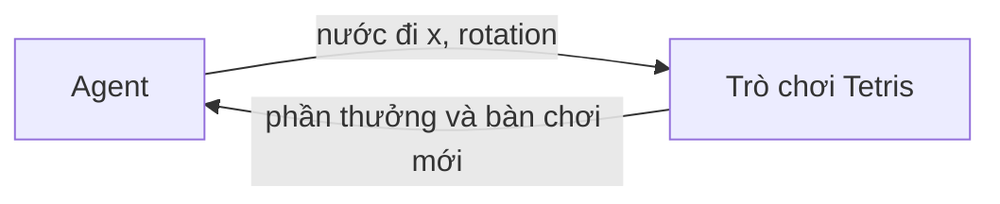
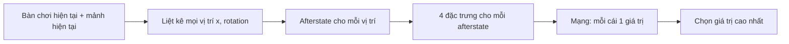
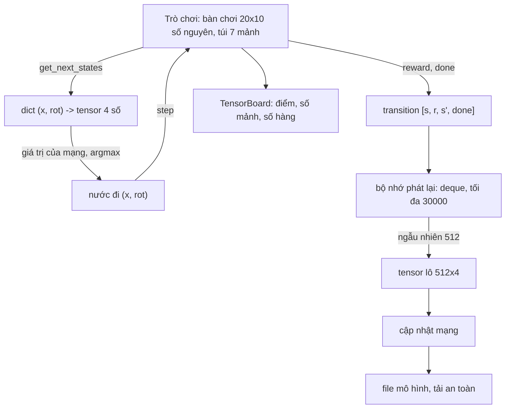
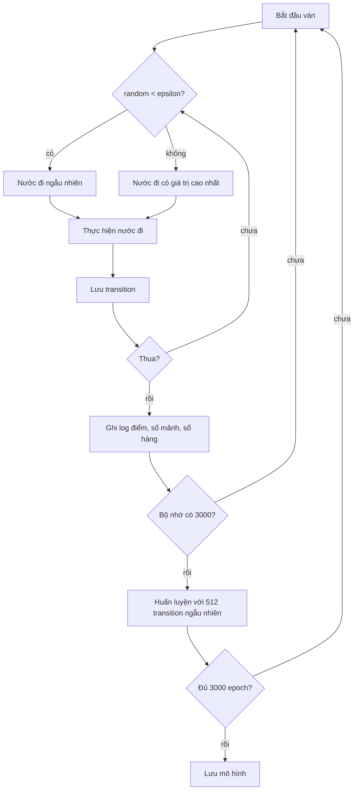

# Bài giảng: dạy máy tính chơi Tetris bằng Deep Q-Learning

🇬🇧 English version: [lecture.en.md](lecture.en.md)

Bài giảng này giải thích dự án từ ý tưởng ban đầu đến các phương pháp và những chủ đề nên học tiếp.
Bài viết dành cho người chưa có nền tảng về AI. Mỗi thuật ngữ mới có một định nghĩa ngắn ở lần dùng đầu tiên.
Thuật ngữ tiếng Anh được giữ trong ngoặc, vì bạn sẽ gặp chúng trong code và tài liệu.
Các notebook trình bày cùng những chủ đề này dưới dạng bài thực hành:
[Bài 1](../../notebooks/01_game_and_state.ipynb),
[Bài 2](../../notebooks/02_network_and_decisions.ipynb),
[Bài 3](../../notebooks/03_training_loop.ipynb),
[Bài 4](../../notebooks/04_reward_lab.ipynb).

## Mục lục

1. [Ý tưởng](#1-ý-tưởng)
2. [Trò chơi dưới dạng dữ liệu: cấu trúc dữ liệu](#2-trò-chơi-dưới-dạng-dữ-liệu-cấu-trúc-dữ-liệu)
3. [Các phương pháp AI](#3-các-phương-pháp-ai)
4. [Vòng lặp huấn luyện, từng bước](#4-vòng-lặp-huấn-luyện-từng-bước)
5. [Thước đo: làm sao biết agent đang học](#5-thước-đo-làm-sao-biết-agent-đang-học)
6. [Agent đã học được gì](#6-agent-đã-học-được-gì)
7. [Giới hạn của thiết kế này](#7-giới-hạn-của-thiết-kế-này)
8. [Chủ đề nên học tiếp](#8-chủ-đề-nên-học-tiếp)
9. [Bảng thuật ngữ](#9-bảng-thuật-ngữ)
10. [Tài liệu tham khảo](#10-tài-liệu-tham-khảo)

---

## 1. Ý tưởng

### 1.1 Học từ phần thưởng, không học từ ví dụ

Hầu hết chương trình làm theo quy tắc do con người viết. Dự án này không có quy tắc nào như "đừng tạo lỗ".
Thay vào đó, chương trình chơi rất nhiều ván và nhận một con số sau mỗi nước đi. Con số đó nói "tốt" hay "xấu".
Chương trình tự thay đổi để nhận được nhiều con số đó hơn. Đây là **học tăng cường (reinforcement learning — RL)**.

5 thành phần của RL trong dự án này:

| Thuật ngữ RL | Ý nghĩa | Trong dự án này |
|---|---|---|
| **Agent** (tác tử) | chương trình ra quyết định | mạng nơ-ron cộng với quy tắc chọn nước đi |
| **Environment** (môi trường) | thế giới mà agent hành động trong đó | trò chơi Tetris, `src/tetris.py` |
| **State** (trạng thái) | những gì agent biết về thế giới lúc này | 4 con số mô tả bàn chơi |
| **Action** (nước đi) | những gì agent có thể làm | vị trí cuối cùng của mảnh: `(x, rotation)` |
| **Reward** (phần thưởng) | con số sau mỗi nước đi | `1 + lines² × 10` |



### 1.2 Ba quyết định thiết kế làm bài toán nhỏ lại

1. **Agent chọn vị trí cuối cùng của mảnh.** Nó không bấm trái, phải hay xoay.
   Trò chơi liệt kê mọi vị trí cuối cùng có thể. Vậy một quyết định = một mảnh.
2. **Agent nhìn 4 con số, không nhìn 200 ô.** Con người đã chọn 4 đặc trưng (features) này:
   số hàng xóa được, số lỗ, độ gồ ghề và chiều cao. Một mạng rất nhỏ có thể học từ 4 con số trong vài phút.
3. **Agent chấm điểm bàn chơi, không chấm điểm nước đi.** Với mỗi vị trí có thể, trò chơi tạo ra bàn chơi
   sẽ xuất hiện sau đó (một **afterstate** — trạng thái sau nước đi). Mạng cho mỗi afterstate một con số (**giá trị** — value).
   Agent chọn vị trí có giá trị cao nhất.



Các quyết định này đổi tính tổng quát lấy tốc độ. Agent không thể tự khám phá đặc trưng mới.
Nhưng nó học chơi tốt trên CPU của laptop trong khoảng 5 phút.

---

## 2. Trò chơi dưới dạng dữ liệu: cấu trúc dữ liệu

### 2.1 Bàn chơi

Bàn chơi là một danh sách gồm 20 hàng. Mỗi hàng là một danh sách gồm 10 số nguyên.

- `0` = ô trống
- `1` đến `7` = một khối của một loại mảnh (con số quyết định màu)

```python
board = [[0] * 10 for _ in range(20)]   # hàng 0 là hàng trên cùng
```

### 2.2 Các mảnh và túi mảnh

`Tetris.pieces` chứa 7 lưới số nhỏ, mỗi lưới cho một **tetromino** (hình gồm 4 khối): O, T, S, Z, I, L, J.
`rotate()` xoay một lưới 90° theo chiều kim đồng hồ.

Mảnh tiếp theo lấy từ một **túi (bag)**: một danh sách 7 số của các mảnh theo thứ tự ngẫu nhiên.
Trò chơi lấy mảnh từ túi cho đến khi túi rỗng, sau đó xáo trộn một túi mới.
Vì vậy mỗi loại mảnh xuất hiện một lần trong mỗi nhóm 7 mảnh. Không thể có một chuỗi dài không có mảnh I.

### 2.3 Nước đi

Một nước đi là một tuple `(x, rotation)`:

- `x` = cột bên trái của mảnh
- `rotation` = số lần xoay 90°

Số kiểu xoay phụ thuộc vào mảnh: O có 1, S, Z và I có 2, T, L và J có 4.
Vì vậy số nước đi thay đổi theo từng mảnh (9 cho mảnh O, 34 cho T, L và J).
Đây là một lý do mạng chấm điểm bàn chơi chứ không chấm điểm nước đi (mục 3.2).

### 2.4 Trạng thái: 4 đặc trưng

`get_state_properties(board)` trả về một tensor gồm 4 số thực (**tensor** là kiểu mảng của PyTorch):

```python
torch.FloatTensor([lines_cleared, holes, bumpiness, height])
```

| Đặc trưng | Định nghĩa |
|---|---|
| `lines_cleared` | số hàng đầy mà nước đi này xóa (code xóa chúng trước, sau đó mới đo phần còn lại) |
| `holes` | ô trống có khối nằm ở đâu đó phía trên trong cùng cột |
| `bumpiness` | tổng chênh lệch chiều cao giữa các cột cạnh nhau |
| `height` | tổng chiều cao của cả 10 cột |

### 2.5 Afterstate

`get_next_states()` trả về một dictionary:

```python
{(x, rotation): tensor([lines_cleared, holes, bumpiness, height]), ...}
```

Với mỗi nước đi, trò chơi thả mảnh xuống một bản sao của bàn chơi và đo kết quả.
Bàn chơi thật không thay đổi. Chỉ `step(action)` mới thay đổi bàn chơi thật.

### 2.6 Transition và bộ nhớ phát lại

Sau mỗi nước đi, agent lưu một **transition** (bước chuyển), là một danh sách gồm 4 phần tử:

```python
[state, reward, next_state, done]
```

- `state`: 4 đặc trưng trước nước đi (afterstate của nước đi trước đó)
- `reward`: phần thưởng của nước đi này
- `next_state`: 4 đặc trưng của afterstate mà agent đã chọn
- `done`: `True` nếu nước đi này làm kết thúc ván

**Bộ nhớ phát lại (replay memory)** là một `collections.deque` với `maxlen=30000`. Khi đầy, transition cũ nhất bị loại ra.
Mỗi bước huấn luyện lấy ngẫu nhiên 512 transition và xếp chúng thành các tensor có kích thước `512 × 4`.

### 2.7 File mô hình và log

- `torch.save(model, path)` ghi toàn bộ đối tượng Python (một **pickle** — định dạng lưu đối tượng của Python).
  File pickle có thể chạy code khi được tải. Vì vậy dự án này tải mô hình ở chế độ an toàn của PyTorch (`weights_only=True`)
  bằng `src/model_io.py`.
- `tensorboardX.SummaryWriter` ghi 3 con số cho mỗi ván để xem bằng **TensorBoard** (công cụ vẽ biểu đồ):
  điểm, số mảnh (tetrominoes) và số hàng đã xóa.



---

## 3. Các phương pháp AI

### 3.1 Phần thưởng

`step()` trả về `1 + lines_cleared² × width`, với `width = 10`:

| Số hàng trong một nước đi | 0 | 1 | 2 | 3 | 4 |
|---|---|---|---|---|---|
| Phần thưởng | 1 | 11 | 41 | 91 | 161 |

- `+1` cho mỗi mảnh: "hãy sống sót".
- Bình phương: xóa 4 hàng cùng lúc (161) được nhiều hơn rất nhiều so với 4 lần xóa 1 hàng (44). Điều này khiến agent chuẩn bị cho những lần xóa lớn.
- `× width`: một hàng có giá trị bằng 10 mảnh đã đặt, nên hàng rõ ràng quan trọng hơn việc sống sót.

Khi thua (game over), code trừ 2 khỏi `env.score`, nhưng `step()` không trả về con số đó. Vì vậy agent không bao giờ thấy
hình phạt. Hình phạt thật sự là không còn phần thưởng nào trong tương lai (mục 3.5).
[Bài 4](../../notebooks/04_reward_lab.ipynb) so sánh phần thưởng này với 4 hàm phần thưởng khác.

### 3.2 Hàm giá trị trên afterstate

**Giá trị** của một bàn chơi là tổng phần thưởng mà ta kỳ vọng nhận được sau nó.
Phần thưởng tương lai được tính ít hơn một chút sau mỗi bước, theo **hệ số chiết khấu (discount factor)** γ = 0.99:

```
value(board) = r1 + γ·r2 + γ²·r3 + ...
```

Q-learning cổ điển học `Q(state, action)`, mỗi nước đi một con số. Ở đây mạng học `V(afterstate)`,
mỗi bàn chơi một con số. Cách này đơn giản hơn vì:

- số nước đi thay đổi theo từng mảnh, nhưng afterstate nào cũng luôn có 4 đặc trưng;
- nhiều nước đi cho ra những bàn chơi trông giống nhau, và mạng có thể dùng chung những gì đã học giữa chúng.

Sutton và Barto gọi đây là **hàm giá trị afterstate (afterstate value function)**.

### 3.3 Mạng nơ-ron

`src/deep_q_network.py` định nghĩa một **MLP** nhỏ (multi-layer perceptron — một chồng các lớp kết nối đầy đủ):

```
4 đặc trưng -> Linear(4, 64) -> ReLU -> Linear(64, 64) -> ReLU -> Linear(64, 1) -> 1 giá trị
```

- **Lớp Linear (tuyến tính):** mỗi đầu ra là tổng có trọng số của mọi đầu vào cộng với độ lệch (bias). Trọng số là thứ mà huấn luyện thay đổi.
- **ReLU:** `max(0, x)`. Nó thêm một chỗ gập, để mạng học được quan hệ đường cong. ReLU không phải là nước đi.
- **Khởi tạo Xavier:** trọng số ban đầu là ngẫu nhiên, với độ lớn phù hợp với kích thước lớp. Bias bắt đầu bằng 0.
- Kích thước: 4·64 + 64 + 64·64 + 64 + 64 + 1 = **4.545** trọng số.

Các lớp có tên `conv1`, `conv2` và `conv3`, nhưng chúng không phải lớp tích chập (convolution).

### 3.4 Khám phá: epsilon-greedy

- **Khám phá (exploration):** thử một nước đi ngẫu nhiên để tìm ra điều mới.
- **Khai thác (exploitation):** chọn nước đi tốt nhất mà mạng biết hiện tại.
- **Epsilon (ε):** xác suất chọn nước đi ngẫu nhiên.

ε giảm theo đường thẳng từ 1.0 xuống 0.001 trong 2000 epoch đầu, sau đó giữ ở 0.001.
Lúc đầu mạng chưa biết gì, nên nước đi ngẫu nhiên cho kinh nghiệm đa dạng hơn.

### 3.5 Mục tiêu Bellman

Ta không biết giá trị thật của một bàn chơi. Vì vậy mạng học từ chính ước lượng của nó cho bàn chơi tiếp theo:

```
target = reward                              nếu ván đã kết thúc
target = reward + γ · V(next_state)          nếu không
```

Đây là **phương trình Bellman**. Vì mạng tự tạo mục tiêu cho chính nó, cách này gọi là **bootstrapping**.
Khi ván kết thúc, mục tiêu không có phần tương lai. Vì vậy những bàn chơi làm kết thúc ván nhận giá trị thấp.
Đây là hình phạt thật sự khi thua.

### 3.6 Hàm mất mát và bộ tối ưu

- **Loss (mất mát):** `MSE` (sai số bình phương trung bình), trung bình của `(V(state) − target)²` trên cả lô.
- **Lan truyền ngược (backpropagation):** `loss.backward()` tính, với mỗi trọng số, loss thay đổi thế nào theo nó.
- **Adam:** `optimizer.step()` thay đổi mỗi trọng số một chút để loss nhỏ hơn. Tốc độ học (learning rate) = 0.001.

### 3.7 Phát lại kinh nghiệm (experience replay)

Agent học từ một mẫu ngẫu nhiên các transition cũ, không chỉ từ nước đi cuối cùng. Có hai lý do:

- Các nước đi trong một ván rất giống nhau. Mẫu ngẫu nhiên từ nhiều ván cho một bài học cân bằng hơn.
- Mỗi transition có thể dạy mạng nhiều lần.

### 3.8 Các thiết lập (mặc định của `train.py`)

| Thiết lập | Giá trị | Ý nghĩa |
|---|---|---|
| `batch_size` | 512 | số transition trong mỗi bước huấn luyện |
| `lr` | 0.001 | tốc độ học của Adam |
| `gamma` | 0.99 | hệ số chiết khấu |
| `initial_epsilon` → `final_epsilon` | 1.0 → 0.001 | xác suất chọn nước đi ngẫu nhiên |
| `num_decay_epochs` | 2000 | số epoch để ε giảm xong |
| `num_epochs` | 3000 | tổng số bước huấn luyện |
| `replay_memory_size` | 30000 | kích thước bộ nhớ phát lại |
| `save_interval` | 1000 | lưu một bản sao mô hình sau mỗi 1000 epoch |

---

## 4. Vòng lặp huấn luyện, từng bước

Trong `train.py`, **1 epoch = 1 ván = 1 bước huấn luyện**. Huấn luyện bắt đầu khi bộ nhớ có 3.000 transition
(một phần mười kích thước của nó).

```
memory = deque rỗng (tối đa 30000)
state = bắt đầu ván mới
lặp lại cho đến 3000 epoch:
    epsilon = giảm tuyến tính(epoch)
    afterstates = game.get_next_states()
    nếu random < epsilon: chọn nước đi ngẫu nhiên
    nếu không:            chọn argmax V(afterstate)
    reward, done = game.step(action)
    memory.add([state, reward, afterstate đã chọn, done])
    nếu chưa done: state = afterstate đã chọn; tiếp tục chơi    # chưa huấn luyện
    ghi log điểm, số mảnh, số hàng; state = bắt đầu ván mới
    nếu bộ nhớ có ít hơn 3000 phần tử: tiếp tục
    epoch += 1
    batch = 512 transition ngẫu nhiên
    target = reward + gamma * V(next_state) * (1 - done)
    loss = MSE(V(state), target)
    một bước Adam
lưu mô hình
```



Các notebook thêm giới hạn `max_pieces` mảnh mỗi ván, để một ván không kéo dài mãi.
Khi ván đạt giới hạn, vòng lặp dừng nó nhưng **không** đặt `done`. Bàn chơi chưa thua,
nên giá trị tương lai của nó vẫn có thật. RL gọi đây là **cắt ngắn (truncation)**, không phải **kết thúc (termination)**.

---

## 5. Thước đo: làm sao biết agent đang học

`train.py` ghi 3 con số cho mỗi ván vào TensorBoard:

| Thước đo | Đo cái gì | Tại sao dùng |
|---|---|---|
| **Điểm (score)** | tổng phần thưởng trong một ván | đại lượng mà agent cố làm cho lớn |
| **Số mảnh (tetrominoes)** | số mảnh đã đặt trước khi thua | sự sống sót, dễ hiểu |
| **Số hàng đã xóa (cleared lines)** | số hàng đầy đã bị xóa | mục tiêu thật của Tetris |

Quy tắc khi đọc các thước đo:

- **Đừng dùng loss để đo tiến bộ.** Mục tiêu thay đổi khi mạng thay đổi, nên loss có thể tăng
  trong khi agent chơi tốt hơn. Hãy đo kết quả chơi.
- **Nhìn giá trị trung bình.** Thứ tự các mảnh là ngẫu nhiên, nên một ván cho biết rất ít. Các notebook vẽ
  trung bình của 50 ván gần nhất.
- **Kiểm tra không có khám phá.** Sau khi huấn luyện, chơi các ván kiểm tra với ε = 0, để nước đi ngẫu nhiên không che mất kết quả.
- **So sánh các phần thưởng khác nhau bằng số hàng và số mảnh, không bao giờ bằng điểm.** Mỗi hàm phần thưởng cho một thang điểm khác nhau.
- **Dùng nhiều hơn một seed.** **Seed** cố định các số ngẫu nhiên. Với một seed, kết quả có thể chỉ là may mắn.
  Ở Bài 4, thứ tự của 5 phần thưởng thay đổi theo từng seed.
- **Số hàng ≈ 0,4 × số mảnh** với mọi agent sống sót được. Mỗi mảnh thêm 4 ô và mỗi hàng xóa 10 ô.

Agent ngẫu nhiên đặt khoảng 20 mảnh và gần như không xóa được hàng nào.
Agent đã huấn luyện của tác giả đặt khoảng 300–360 mảnh với giới hạn 500, và xóa khoảng 115–130 hàng.

---

## 6. Agent đã học được gì

Ta có thể hỏi mạng đã huấn luyện: thay đổi một đặc trưng, giữ cố định 3 đặc trưng còn lại, và xem giá trị thay đổi thế nào.
Mạng của tác giả, với các đặc trưng còn lại ở `holes=2, bumpiness=6, height=30`:

| Đặc trưng | Ảnh hưởng lên giá trị |
|---|---|
| `holes` | khoảng −23 cho lỗ đầu tiên, sau khoảng 10 lỗ thì ít hơn |
| `bumpiness` | khoảng −5 cho mỗi đơn vị từ 6 đến 20 |
| `height` | khoảng +1 cho mỗi đơn vị, đến tổng khoảng 100, sau đó giảm một chút |
| `lines_cleared` | gần như không ảnh hưởng (−10 cho 4 hàng, khoảng 1%) |

Điều này cho ta biết:

- Không ai viết "lỗ là xấu". Mạng tự học điều đó chỉ từ phần thưởng.
- 1 lỗ bị trừ gần bằng 5 đơn vị độ gồ ghề. Agent chấp nhận bàn chơi gồ ghề hơn để tránh một lỗ.
- `lines_cleared` gần như không ảnh hưởng, vì phần thưởng cho những hàng này đã được trả rồi.
  Giá trị của một afterstate nói về tương lai.
- Chiều cao làm giá trị **tăng**, một điều bất ngờ. Lý do có khả năng: khi có ít lỗ, một chồng khối cao và phẳng có nhiều hàng gần đầy,
  nên hàng sẽ đến sớm. Nhưng trong ván thật các đặc trưng thay đổi cùng nhau, nên phép thử từng đặc trưng cho thấy những bàn chơi không bao giờ xảy ra.

Chỉ có chênh lệch giữa các giá trị là quan trọng. Agent so sánh các afterstate từ cùng một bàn chơi và chọn cái cao nhất.

---

## 7. Giới hạn của thiết kế này

| Giới hạn | Hệ quả |
|---|---|
| Không có mạng mục tiêu (target network) | mục tiêu dịch chuyển sau mỗi bước, nên huấn luyện không ổn định và một mạng tốt có thể tệ đi |
| Lựa chọn bỏ qua phần thưởng của nước đi | agent chọn bằng `argmax V(afterstate)`, không phải `argmax (reward + γ·V(afterstate))` |
| 4 đặc trưng do con người làm | agent không thấy những mẫu nằm ngoài các đặc trưng này, ví dụ một giếng sâu |
| Không nhìn trước | trò chơi biết mảnh tiếp theo, nhưng agent không dùng nó |
| Không có hình phạt thua thật sự | −2 không được trả về, nên agent chỉ học tránh thua qua việc mất phần thưởng tương lai |
| Lưu mạng cuối cùng | mạng cuối cùng không phải lúc nào cũng tốt nhất |
| Mỗi lần chạy một seed | kết quả có thể chỉ là may mắn |

---

## 8. Chủ đề nên học tiếp

### 8.1 Làm DQN ổn định hơn

| Chủ đề | Ý tưởng | Nguồn |
|---|---|---|
| **Target network** (mạng mục tiêu) | tạo mục tiêu bằng một bản sao "đóng băng" của mạng, và sao chép trọng số sau mỗi N bước | Mnih và cộng sự, 2015 |
| **Double DQN** | chọn bằng một mạng và chấm điểm bằng mạng kia, để giảm các giá trị quá cao | van Hasselt và cộng sự, 2016 |
| **Prioritized replay** (phát lại có ưu tiên) | lấy mẫu thường xuyên hơn những transition có sai số lớn | Schaul và cộng sự, 2016 |
| **n-step returns** | dùng phần thưởng của nhiều bước trước khi bootstrap | Sutton và Barto, chương 7 |
| **Huber loss** | hàm mất mát tăng chậm hơn MSE khi sai số lớn, nên phần thưởng lớn tạo bước nhảy nhỏ hơn | thực hành phổ biến của DQN |
| **Rainbow** | kết hợp 6 cải tiến của DQN | Hessel và cộng sự, 2018 |

### 8.2 Quyết định tốt hơn

- **Thêm phần thưởng của nước đi vào lựa chọn:** `argmax (reward + γ·V(afterstate))`. Đây là quy tắc chọn tham lam thông thường cho giá trị afterstate.
- **Nhìn trước với mảnh tiếp theo:** với mỗi vị trí của mảnh hiện tại, thử mọi vị trí của mảnh tiếp theo, và chọn cặp tốt nhất.
- **Giữ mạng tốt nhất:** cứ N bước thì kiểm tra với ε = 0, và lưu mạng khi nó tốt nhất từ trước đến giờ.

### 8.3 Phần thưởng tốt hơn

- **Potential-based shaping** (định hình phần thưởng dựa trên thế năng): cộng `γ·Φ(bàn mới) − Φ(bàn cũ)` vào phần thưởng, ví dụ với `Φ = −holes`.
  Khoản thưởng này giúp việc học và không thay đổi chiến lược tốt nhất (Ng, Harada và Russell, 1999).
- **Hình phạt thua thật sự:** ví dụ −20 khi một nước đi làm kết thúc ván. Bài 4 có bài tập cho việc này.

### 8.4 Tự học đặc trưng

- **Đầu vào là bàn chơi thô:** đưa 200 ô vào một **mạng nơ-ron tích chập (convolutional neural network)** (mạng nhìn vào từng vùng nhỏ
  của một hình ảnh). Nó có thể tự tìm đặc trưng, nhưng cần huấn luyện lâu hơn nhiều.
- **Thêm đặc trưng:** chiều cao của cột cao nhất, giếng (wells), số lần chuyển trạng thái theo hàng và theo cột.

### 8.5 Các phương pháp khác cho cùng bài toán

- **Policy gradient và PPO:** học trực tiếp quy tắc chọn nước đi, không học giá trị.
- **Phương pháp cross-entropy:** tìm trọng số tốt cho một hàm điểm tuyến tính của các đặc trưng bằng cách thử và chọn lọc.
  Với Tetris, phương pháp đơn giản này cùng các đặc trưng tốt là rất mạnh (Szita và Lőrincz, 2006).
- **Thuật toán di truyền (genetic algorithms):** tương tự phương pháp cross-entropy, với đột biến và chọn lọc các bộ trọng số.
- **Bộ điều khiển chỉnh tay:** con người đặt trọng số cho các đặc trưng. Một số trong đó thuộc nhóm chơi Tetris mạnh nhất.

### 8.6 Lý thuyết nền tảng

- Quá trình quyết định Markov (Markov decision process), hàm giá trị và phương trình Bellman: Sutton và Barto, chương 3–6.
- Afterstate: Sutton và Barto, mục 6.8.
- Tại sao Tetris khó: chơi hoàn hảo là bài toán NP-khó, kể cả khi biết trước mọi mảnh (Demaine và cộng sự, 2003).

---

## 9. Bảng thuật ngữ

| Thuật ngữ | Ý nghĩa |
|---|---|
| Action (nước đi) | vị trí cuối cùng `(x, rotation)` của mảnh hiện tại |
| Afterstate (trạng thái sau nước đi) | bàn chơi sau một nước đi, trước khi có mảnh tiếp theo |
| Agent (tác tử) | chương trình ra quyết định |
| Bootstrapping | học từ chính ước lượng của mình về giá trị tiếp theo |
| Discount factor (γ, hệ số chiết khấu) | phần thưởng được tính ít đi bao nhiêu cho mỗi bước trong tương lai |
| Epoch | ở đây: 1 ván = 1 bước huấn luyện |
| Epsilon-greedy | chọn nước đi ngẫu nhiên với xác suất ε, nếu không thì chọn nước đi tốt nhất |
| Feature (đặc trưng) | một con số mô tả bàn chơi |
| Loss (mất mát) | con số cho biết mạng sai bao nhiêu |
| Replay memory (bộ nhớ phát lại) | nơi lưu các transition cũ để lấy mẫu ngẫu nhiên |
| Reward (phần thưởng) | con số mà trò chơi trả về sau mỗi nước đi |
| Seed | con số cố định các số ngẫu nhiên của một lần chạy |
| Transition (bước chuyển) | `[state, reward, next_state, done]` |
| Truncation (cắt ngắn) | dừng ván ở một giới hạn, mà không thua |
| Value (giá trị) | tổng phần thưởng tương lai mà ta kỳ vọng từ một bàn chơi |

---

## 10. Tài liệu tham khảo

- Sutton, R. S. and Barto, A. G. (2018). *Reinforcement Learning: An Introduction*, 2nd edition. MIT Press.
- Mnih, V. et al. (2015). Human-level control through deep reinforcement learning. *Nature* 518.
- van Hasselt, H., Guez, A. and Silver, D. (2016). Deep reinforcement learning with double Q-learning. AAAI.
- Schaul, T. et al. (2016). Prioritized experience replay. ICLR.
- Hessel, M. et al. (2018). Rainbow: combining improvements in deep reinforcement learning. AAAI.
- Ng, A. Y., Harada, D. and Russell, S. (1999). Policy invariance under reward transformations. ICML.
- Szita, I. and Lőrincz, A. (2006). Learning Tetris using the noisy cross-entropy method. *Neural Computation* 18.
- Demaine, E. D., Hohenberger, S. and Liben-Nowell, D. (2003). Tetris is hard, even to approximate. COCOON.
